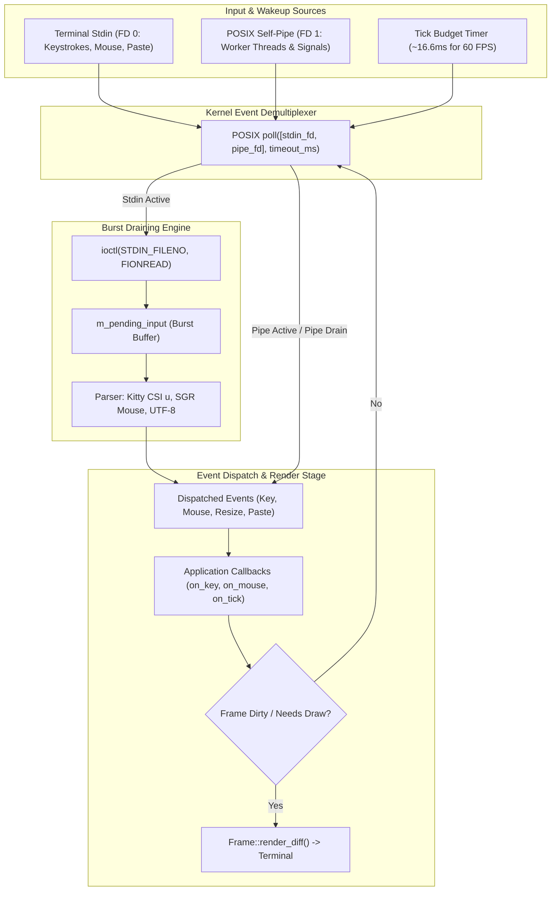

# The libkoto Event Loop & Concurrency Model

Deep architectural analysis of `libkoto`'s POSIX event polling, non-blocking burst draining, thread-safe self-pipe wakeups, Kitty keyboard protocol decoding, and terminal resize handling.

---

## Architecture & System Overview

Terminal UI applications require smooth 60 FPS rendering under heavy user input while consuming **0% CPU when idle**. 

`libkoto` achieves this through a unified event loop built on POSIX `poll()`, non-blocking I/O, self-pipe signaling, and input burst draining:



---

## Event Burst Draining Architecture

When a user pastes large blocks of code or when a terminal emulator emits multi-byte ANSI sequences, the data arrives in rapid bursts. Processing input byte-by-byte with an intervening render pass would trigger hundreds of redundant redraws per second.

```
Kernel Stdin:   [ \x1b [ 2 0 0 ~ H e l l o \x1b [ 2 0 1 ~ ] (512 bytes)
                    │
                    ▼ (Single read() syscall via ioctl FIONREAD)
Memory Buffer:  [ \x1b[200~Hello\x1b[201~ ]
                    │
                    ▼ (Drained synchronously in user space)
Dispatch:       dispatch_event(PasteEvent{"Hello"})
                    │
                    ▼
Redraw Pass:    Render frame ONCE (Zero lag, zero frame tearing)
```

1. Upon the first byte arriving, `EventLoop` queries pending kernel bytes using `ioctl(STDIN_FILENO, FIONREAD, &bytes_avail)`.
2. All available bytes are read into `m_pending_input` in a single system call.
3. `App::run()` drains all parsed events from memory before executing the render pass. Redraw occurs at most once per frame.

---

## Thread-Safe Cross-Thread Wakeup (POSIX Self-Pipe)

Background worker threads (e.g., background telemetry pollers, network RPC workers, compilation tasks) need to update UI state without causing race conditions or deadlocks:

```cpp
auto EventLoop::wakeup() noexcept -> void
{
    if (m_pipe_fds[1] >= 0)
    {
        char b = 'W';
        [[maybe_unused]] ssize_t written = ::write(m_pipe_fds[1], &b, 1);
    }
}
```

* **File Descriptor Flags**: Both ends of the self-pipe are configured with `O_CLOEXEC` and `O_NONBLOCK`.
* **Async Signal Safety**: `write()` to a pipe descriptor is officially async-signal-safe per POSIX standards.
* **Lock-Free**: Calling `app.wakeup()` acquires no mutexes and never blocks the calling thread, making it safe to invoke from high-frequency telemetry loops.

---

## Signal Handling & Terminal Resizing (`SIGWINCH`)

When the user resizes their terminal window, the operating system sends `SIGWINCH` to the process:
1. The global signal handler catches `SIGWINCH` and performs a non-blocking 1-byte write to the self-pipe.
2. The main loop unblocks from `poll()` immediately.
3. `EventLoop` reads window dimensions via `ioctl(STDOUT_FILENO, TIOCGWINSZ, &ws)`.
4. `ResizeEvent{rows, cols}` is emitted, prompting `Frame` to reallocate grid buffers and perform a full repaint.

---

## Keyboard Protocol & Escape Sequence Parsing

`libkoto` natively handles legacy ANSI escape sequences as well as modern enhanced protocols:

| Sequence Type | Protocol | Example Bytes | Dispatched Event |
|:---|:---|:---|:---|
| **Standard ASCII** | Direct byte | `'q'`, `'A'`, `'\n'` | `KeyEvent{.key = Key::Char}` |
| **ANSI Escape** | VT100 / xterm | `\x1b[A`, `\x1b[B` | `KeyEvent{.key = Key::Up / Down}` |
| **Kitty Keyboard** | Enhanced CSI u | `\x1b[13;5u` | `KeyEvent{.key = Key::Enter, .modifiers = Ctrl}` |
| **Bracketed Paste**| Dec Mode 2004 | `\x1b[200~...` | `PasteEvent{.text = "..."}` |
| **SGR Mouse** | Dec Mode 1006 | `\x1b[<0;10;5M`| `MouseEvent{.action = Press, .col = 10, .row = 5}` |

---

## C++ Language Features Utilized

1. **`std::variant` Event Modeling (C++17)**: `Event` is implemented as a type-safe union of `KeyEvent`, `MouseEvent`, `ResizeEvent`, and `PasteEvent`.
2. **`noexcept` Move Semantics (C++11)**: Event queue push and pop operations are annotated `noexcept` for deterministic latency.
3. **RAII Descriptor Lifecycle (C++11)**: `EventLoop` encapsulates pipe descriptors (`m_pipe_fds`), automatically closing them upon destruction.
4. **Attributes for Unused Values (`[[maybe_unused]]`) (C++17)**: Annotates system call returns (`ssize_t written = ::write(...)`) under strict warning flags.
5. **Non-Blocking POSIX System Calls**: Direct usage of `::poll()`, `::read()`, `fcntl()`, and `ioctl(FIONREAD)`.
