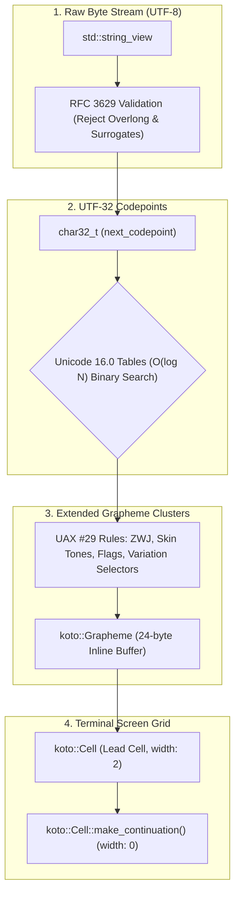

# Unicode 16.0 & Grapheme Handling in `libkoto`

Technical specification of `libkoto`'s RFC 3629 stream decoder, Unicode 16.0 UAX #11 East Asian Width tables, UAX #29 extended grapheme cluster segmentation, and double-buffered continuation cell protocol.

---

## Conceptual Overview & Problem Statement

Terminal emulators treat the screen as an integer 2D matrix of columns and rows. However, modern Unicode text does not conform to 1 byte = 1 character = 1 column:

```
Character:         'A'           '琴'            '👍🏽'                 '👩‍💻'
Bytes (UTF-8):     1 (0x41)      3 (E7 90 B4)    8 (F0 9F 91 8D ...)  11 (F0 9F 91 A9 ...)
Codepoints:        1 (U+0041)    1 (U+7434)      2 (U+1F44D, U+1F3FD) 3 (U+1F469, U+200D, U+1F4BB)
Grapheme Clusters: 1             1               1                    1
Visual Width:      1 column      2 columns       2 columns            2 columns
```

If an engine calculates column offsets using byte sizes (`std::string::size()`) or codepoint counts (`std::u32string::size()`), layouts skew, borders misalign, and terminal cursors drift.

---

## The Four Unicode Dimensions in `libkoto`



---

## The Continuation Cell Protocol & Overwrites

```
Row Index 0:
Col 0: [ '琴' (Width 2, Continuation = false) ]
Col 1: [ Cell::make_continuation() (Width = 0, Continuation = true) ]
Col 2: [ 'A' (Width 1, Continuation = false) ]

ANSI Emission: "琴A" (Continuation cell at Col 1 emits ZERO bytes)
```

1. **Terminal Synchronization**: Terminal hardware cursors automatically advance 2 columns when printing a width-2 character. Skipping the continuation cell during diff emission keeps virtual and physical cursors perfectly aligned.
2. **Left/Right Overwrite Safety**: Overwriting either half of a wide character cleanly neutralizes the other half with space characters (`U' '`), preventing orphaned trailing glyph fragments.

---

## Unicode 16.0 Interval Lookup Tables

`libkoto` embeds synchronized Unicode 16.0 tables in `src/unicode_data.inc`:

1. **Zero-Width Ranges (`UNICODE_ZERO_RANGES`)**:
   * C0 and C1 control characters (`0x0000`–`0x001F`, `0x007F`–`0x009F`).
   * Combining diacritical marks (e.g. `U+0300`–`0x036F`).
   * Formatting characters, zero-width spaces (`U+200B`), and Byte Order Marks (`U+FEFF`).
2. **Wide Ranges (`UNICODE_WIDE_RANGES`)**:
   * East Asian Wide (W) and Fullwidth (F) per UAX #11.
   * CJK Ideographs, Hiragana, Katakana, and Hangul.
   * Default emoji presentation per UTS #51.

Lookup execution runs in logarithmic $O(\log N)$ time with non-throwing `noexcept` binary search.

---

## Usage Examples

### 1. Complex Emoji Parsing Without Heap Allocation

```cpp
#include <koto/koto.hpp>
#include <cassert>

using namespace koto;

void test_complex_emoji()
{
    // Compound ZWJ sequence: "👩‍💻"
    std::string_view code_dev = "👩‍💻";
    Grapheme g = next_grapheme(code_dev);

    assert(g.width == 2);
    assert(g.size == 11); // Stored entirely in the 24-byte inline struct!
}
```

---

## Invariants & Safety Guarantees

1. **Zero Heap Allocations**: Grapheme segmentation and codepoint decoding never allocate dynamic memory.
2. **RFC 3629 Sanitization**: Overlong sequences, UTF-16 surrogates (`0xD800`–`0xDFFF`), and codepoints $> \text{U+10FFFF}$ are safely replaced with `U+FFFD`.
3. **No Terminal Cursor Drift**: Visual display width calculations strictly align with hardware terminal rasterization.

---

## C++ Language Features Utilized

1. **`std::array<char, 24>` Inline Storage (C++11)**: Flat byte buffer eliminating heap allocations.
2. **`std::string_view` (C++17)**: High-speed zero-copy stream processing.
3. **`char32_t` Unicode Literals (C++11)**: Native UTF-32 character literals (`U'琴'`, `U'\uFFFD'`).
4. **`noexcept` Binary Search**: Guarantees non-throwing fast interval checks.
