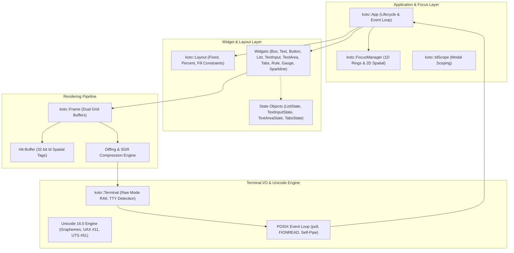

# libkoto: Modern C++23 Terminal UI Framework

> High-performance, zero-allocation, modern C++23 Terminal User Interface (TUI) engine engineered for deterministic state management (`UI = f(state)`), differential double-buffering, universal keyboard decoding, and sub-millisecond redraws.
>
> **GitHub Repository**: [https://github.com/saber-88/koto](https://github.com/saber-88/koto)  
> **Author / Maintainer**: [saber-88](https://github.com/saber-88)

---

## Architecture & System Overview

`libkoto` is structured into four decoupled, cache-conscious architectural layers:



### Text-Based Layer Diagram

```
┌─────────────────────────────────────────────────────────────────────────────┐
│ Layer 4: Application & Focus Engine (koto::App, FocusManager, IdScope)      │
│  - Main event loop with poll() & POSIX self-pipe asynchronous wakeup        │
│  - 1D Tab cycling, auto-harvested 2D spatial navigation, modal focus traps  │
│  - Reactive event subscriptions: on_key, on_mouse, on_paste, on_tick       │
├─────────────────────────────────────────────────────────────────────────────┤
│ Layer 3: Layout Engine & Widget Catalog                                     │
│  - Constraints (Fixed, Percent, Fill) with 16-capacity stack SSO            │
│  - UI = f(state): Decoupled views and mutable state models                  │
│  - Rich widget library: Box, Text, Button, List, TextInput, TextArea, etc.  │
├─────────────────────────────────────────────────────────────────────────────┤
│ Layer 2: Deterministic Double-Buffering & Hit-Testing                       │
│  - Front & back grid buffers (m_front_buffer, m_back_buffer)                │
│  - Cell continuation protocol for wide CJK and multi-byte emoji             │
│  - Hardware-like 32-bit Id hit-buffer for O(1) spatial mouse routing        │
│  - Differential rasterization emitting minimal SGR escape sequences         │
├─────────────────────────────────────────────────────────────────────────────┤
│ Layer 1: Hardware Terminal I/O & Unicode 16.0 Engine                        │
│  - Zero-allocation UTF-8 stream decoding & UAX #29 extended graphemes       │
│  - UAX #11 East Asian Width & UTS #51 emoji variation selector handling     │
│  - POSIX termios raw mode RAII, synchronized updates (\033[?2026h), Kitty   │
└─────────────────────────────────────────────────────────────────────────────┘
```

---

## Single Frame Execution Cycle

The sequence below illustrates the end-to-end flow of one frame within `koto::App`:

```mermaid
sequenceDiagram
    autonumber
    participant OS as OS / Kernel (TTY & Self-Pipe)
    participant Loop as EventLoop (poll & FIONREAD)
    participant App as koto::App
    participant UserLogic as User Callback (on_key / on_tick)
    participant Layout as koto::Layout
    participant Frame as koto::Frame (Back Buffer)
    participant Term as koto::Terminal (Stdout)

    OS->>Loop: Stdin bytes pending or self-pipe wakeup
    Loop->>Loop: Burst drain stdin via ioctl(FIONREAD)
    Loop->>App: Parse KeyEvent, MouseEvent, or PasteEvent
    App->>UserLogic: Dispatch events to active handler
    UserLogic->>UserLogic: Mutate application state models
    App->>Frame: Prepare fresh back-buffer & reset hit-buffer
    App->>UserLogic: Invoke on_render(Frame&)
    UserLogic->>Layout: Partition Area (16-cap SSO stack)
    UserLogic->>Frame: Draw widgets into back-buffer
    App->>Frame: render_diff() [Compare front vs. back buffer]
    Frame->>Term: Emit batched ANSI escape sequences (Sync mode \033[?2026h)
    Term->>OS: Single atomic write() syscall to stdout
    Frame->>Frame: Swap front and back buffer pointers
```

---

## Architectural Highlights

* **True Unicode 16.0 Grapheme Cluster Engine**: `Cell` owns an inline 24-byte grapheme buffer with zero dynamic heap allocation. Emojis with variation selectors (`❤️`), flags (`🇺🇸`), skin-tone modifiers (`👍🏽`), keycaps (`1️⃣`), and ZWJ sequences (`👩‍💻`) render cleanly with automatic continuation cells.
* **Deterministic Double-Buffering**: Screen updates diff `m_front_buffer` and `m_back_buffer`, emitting minimal ANSI escape sequences for dirty regions only.
* **Modern C++23 Architecture**: Monadic error handling (`std::expected`), structured bindings, multi-dimensional grid indexing (`operator[r, c]`), C++20 concepts (`FocusableState`), and zero-overhead moves.
* **Universal `Id` Tokens & 2D Spatial Navigation**: Compile-time FNV-1a hashing generates unique identifiers from string literals, object pointers, enums, or integer coordinates.
* **Thread-Safe Async Wakeups**: Background worker threads can asynchronously push data and wake up the main event loop via a POSIX self-pipe without race conditions.

---

## Quickstart Showcase

```cpp
#include <koto/koto.hpp>

using namespace koto;

int main()
{
    App app;
    ListState hosts({"alpha.internal", "beta.internal", "gamma.internal"});
    hosts.set_selected(0);

    app.on_key([&](const KeyEvent& key) {
        if (key.ch == 'q' || key.ch == 'Q') {
            app.quit();
        }
    });

    app.on_render([&](Frame& frame) {
        // Partition terminal area horizontally: 30% sidebar, 70% content
        auto [sidebar, content] = Layout::horizontal(frame.area(), {
            Constraint::percent(30),
            Constraint::fill()
        });

        // Draw interactive list with rounded borders
        List(hosts)
            .title("Hosts")
            .highlight_symbol("👉 ")
            .border_style(BorderStyle::Rounded)
            .draw(frame, sidebar);

        // Partition content area vertically
        auto [top, bottom] = Layout::vertical(content, {
            Constraint::fixed(3),
            Constraint::fill()
        });

        Box().title("CPU Usage").border_style(BorderStyle::Rounded).draw(frame, top);
        Gauge().percent(72).label("72%").draw(frame, top.inset(1, 1, 1, 1));

        Box().title("System Logs").border_style(BorderStyle::Rounded).draw(frame, bottom);
        Text("Press 'q' to quit.\nConnected to cluster nodes.")
            .draw(frame, bottom.inset(1, 1, 1, 1));
    });

    auto res = app.run();
    if (!res) {
        std::fprintf(stderr, "Failed to run app: %.*s\n",
                     static_cast<int>(res.error().message().size()),
                     res.error().message().data());
        return 1;
    }
    return 0;
}
```

---

## Complete Documentation Index

### Core Architecture
* [Rendering Pipeline](architecture/rendering-pipeline.md): Double-buffering, cell continuation, and dirty diffing.
* [Event Loop](architecture/event-loop.md): Stdin burst draining, POSIX self-pipe wakeup, and Kitty keyboard protocol.
* [Focus System](architecture/focus-system.md): Universal `Id` tokens, 2D spatial navigation, and modal focus traps.

### API Reference
* [`koto::App`](api/app.md): Application lifecycle, event dispatch, frame rates, and render hooks.
* [`koto::Frame`](api/frame.md): Dual grid buffers, cell operations, and plain-text row snapshotting.
* [`koto::Cell`](api/cell.md): Inline grapheme buffer, text attributes (`Bold`, `Underline`), and color tags.
* [`koto::Layout`](api/layout.md): `Area`, `Constraint`, 16-capacity `LayoutResult`, and multi-dimensional `Grid`.
* [`koto::Event`](api/event.md): `KeyEvent`, `MouseEvent`, `ResizeEvent`, and `PasteEvent`.
* [`koto::Terminal`](api/terminal.md): Raw mode RAII, TTY inspection, and color mode quantization.
* [`koto::Color`](api/color.md): 24-bit TrueColor RGB, semantic palette, and linear interpolation (`lerp`).
* [`koto::utf8`](api/utf8.md): Extended grapheme cluster decoding, visual column calculations, and atomic backspace.

### Widget Catalog
* [Box](widgets/box.md): Outlines, borders (Plain, Rounded, Double, Thick), and aligned headers.
* [Text](widgets/text.md): Text alignment (Left, Center, Right) and overflow modes (Clip, Ellipsis, Wrap).
* [Button](widgets/button.md): Focus styling, click callbacks, and hit-buffer registration.
* [List](widgets/list.md): Scrollable item view, selection state, and custom highlight markers.
* [TextInput](widgets/text-input.md): Single-line text editor with atomic grapheme deletion and horizontal scrolling.
* [TextArea](widgets/text-area.md): Multi-line editor with gutter line numbers and sticky visual column navigation.
* [Tabs](widgets/tabs.md): Tab headers, keyboard navigation, and active underline markers.
* [Rule](widgets/rule.md): Horizontal dividers with embedded titles.
* [Gauge](widgets/gauge.md): Percentage progress bar with background-preserving label drawing.
* [Sparkline](widgets/sparkline.md): High-density data graphs rendered using 8 Unicode sub-block characters.

### Guides & Deep Dives
* [Unicode Handling](etc/unicode-handling.md): East Asian Width, variation selectors, and emoji sequences.
* [Performance Guide](etc/performance-guide.md): 44-byte cache alignment, zero heap allocations, and 60 FPS profiling.
* [Troubleshooting](etc/troubleshooting.md): Terminal emulator compatibility and common pitfalls.

---

## C++ Language Features Utilized

1. **`std::expected<T, E>` Monadic Error Handling (C++23)**: `App::run()` returns expected results, enabling zero-exception error checking.
2. **Structured Bindings (C++17)**: `auto [sidebar, content] = Layout::horizontal(...)` unpacks layout partitions cleanly without temporary indexing.
3. **Small Size Optimization (SSO)**: `LayoutResult` uses an inline `std::array<Area, 16>` stack buffer to eliminate dynamic heap allocations.
4. **Lambda Expressions with Reference Captures (`[&]`)**: Clean closures for key dispatch and render loops.
5. **Universal Initialization & Fluent APIs**: Declarative chained widget calls (`.title()`, `.border_style()`).
