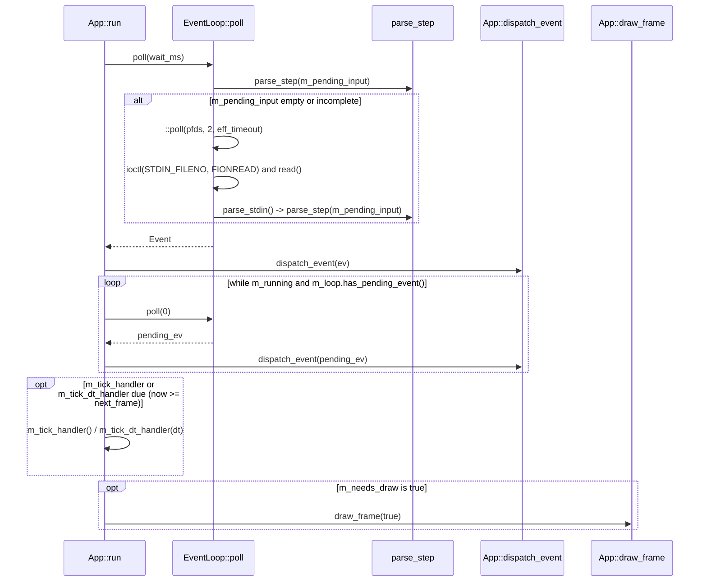

## Overview

The `libkoto` event subsystem spans `koto::App` (`src/app.cpp`) and `koto::EventLoop` (`src/event.cpp`). It combines kernel `::poll()` demultiplexing across `STDIN_FILENO` and a non-blocking POSIX self-pipe (`m_pipe_fds`), `ioctl(STDIN_FILENO, FIONREAD)` burst draining, stateful deadline tracking (`m_escape_deadline` and `m_paste_deadline`), and pre-render event batching.

<!-- src: src/app.cpp:199-323 -->
<!-- src: src/event.cpp:837-1082 -->

## Mermaid diagram

## Walkthrough

1. **Wait timeout computation (`src/app.cpp:237-269`)**:
   - At the top of each iteration in `App::run()`, if `m_loop.has_pending_event() || m_needs_draw` is `true`, `wait_ms` is set to `0` so the loop does not block.
   - Otherwise, if `m_tick_handler` or `m_tick_dt_handler` is registered, `frame_wait` is clamped to `[0, 16]` ms based on `next_frame - clock::now()`.
   - If `m_loop.has_pending()` is `true` (an incomplete escape or UTF-8 sequence is buffered), `wait_ms` is capped at `35` ms (`std::min(35, frame_wait)`).
   - If neither a tick handler nor pending bytes exist, `wait_ms` is `-1` (infinite kernel sleep).
2. **Self-pipe and stdin polling (`src/event.cpp:837-1029`)**:
   - `EventLoop::poll(timeout_ms)` first inspects `m_pending_input` with `parse_step()`. If a complete event is already in memory, it erases `res.consumed` bytes and returns immediately without a syscall.
   - Otherwise, it tightens `eff_timeout` against `m_paste_deadline` (`500` ms) or `m_escape_deadline` (`35` ms) and calls `::poll(pfds, 2, eff_timeout)`.
   - If `m_pipe_fds[0]` is readable (`pfds[1].revents & POLLIN`), it drains up to 64 bytes; if any byte equals `'R'` (written by `EventLoop::on_sigwinch`), it calls `on_resize()` (`ioctl(STDOUT_FILENO, TIOCGWINSZ)`) and returns `ResizeEvent`; otherwise (byte `'W'` from `wakeup()`) it returns `TickEvent{}`.
   - If `STDIN_FILENO` is readable, it drains all available kernel bytes via `ioctl(STDIN_FILENO, FIONREAD, &available)` (falling back to a single 512-byte `read()` if `FIONREAD` returns `<= 0`), refreshes the active deadline, and calls `parse_stdin()`.
3. **User-space batch draining and single render (`src/app.cpp:277-313`)**:
   - After dispatching the first event, `App::run()` loops `while (m_running && m_loop.has_pending_event())` calling `m_loop.poll(0)` and `dispatch_event(pending_ev)`.
   - Once all buffered events are dispatched, `App::run()` fires tick callbacks if `clock::now() >= next_frame` (advancing `next_frame = now + 16ms`) and executes `draw_frame()` at most once for the entire input burst.

<!-- src: src/app.cpp:226-314 -->
<!-- src: src/event.cpp:837-1041 -->

## Invariants

- **No busy-spin on partial sequences**: `has_pending()` is `true` whenever `m_pending_input` is non-empty, whereas `has_pending_event()` is `true` only when `parse_step()` returns `Complete` or `Invalid`, or when `m_escape_deadline` (`35` ms), `m_paste_deadline` (`500` ms), or the `4 MB` paste cap has expired (`src/event.cpp:629-669`). `App::run()` drains on `has_pending_event()`, never on `has_pending()`.
- **Async-signal-safe `SIGWINCH` delivery**: `EventLoop::on_sigwinch` saves `errno`, performs a 1-byte `write(m_pipe_write_fd, "R", 1)`, and restores `errno` (`src/event.cpp:817-826`). `ioctl(TIOCGWINSZ)` and buffer reallocation happen synchronously on the main thread inside `poll()` and `dispatch_event()`.
- **Forward progress on malformed input**: When `parse_step()` returns `ParseStatus::Invalid` (or when a non-ESC orphan byte times out in `flush_incomplete_escape()`), `EventLoop` erases at least `1` byte (`size_t to_drop = res.consumed > 0 ? res.consumed : 1`) so a corrupted byte can never stall the input buffer (`src/event.cpp:716-721, 806-814`).

<!-- src: src/event.cpp:629-826 -->

## See also

- [Events and EventLoop](/api/events/)
- [App](/api/app/)
- [Events and Input Concept](/concepts/events-input/)
