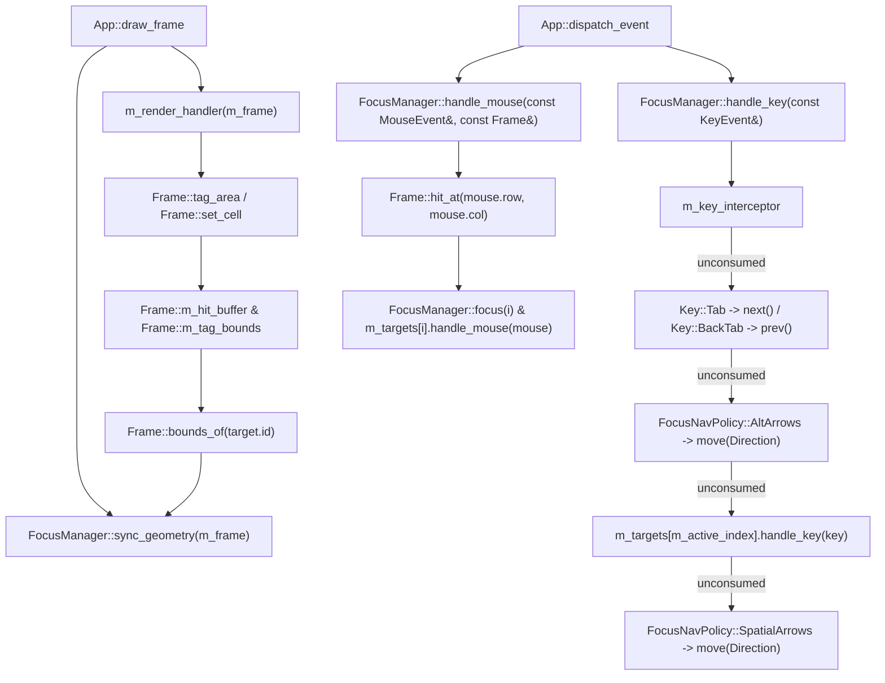

## Overview

`koto::FocusManager` (`include/koto/focus.hpp`, `src/focus.cpp`) decouples input routing and focus state from widget layout. Widgets stamp `Id` tokens into `Frame::m_hit_buffer` and `Frame::m_tag_bounds` during `on_render`, and `FocusManager::sync_geometry(const Frame&)` harvests those rectangles after each frame draw to drive 1D ring traversal, 2D spatial navigation, and mouse hit-testing.

<!-- src: include/koto/focus.hpp:139-313 -->
<!-- src: src/focus.cpp:50-803 -->

## Mermaid diagram

## Walkthrough

1. **Target registration and in-place update (`src/focus.cpp:50-128`)**:
   - `FocusManager::add(T& state, Id custom_id)` constructs a `FocusTarget` with `.id = scoped_id(has_custom ? custom_id : Id(&state))` and `.modal_scope = active_modal_scope()`.
   - `register_target(FocusTarget)` scans `m_targets` for an existing entry with the same `id`. If found, it updates `bounds`, `modal_scope`, and callbacks in place and calls `set_focus(i == m_active_index)` to keep `.focused` synchronized.
   - If the target is new and `m_targets` was empty, it calls `target.set_focus(true)` and sets `m_active_index = 0`. If a `modal scope` is currently active and the currently focused target is outside that modal, `register_target` immediately calls `focus(new_idx)`.
2. **Post-render geometry harvesting (`src/focus.cpp:382-406`)**:
   - After `m_render_handler(m_frame)` completes in `App::draw_frame()`, `FocusManager::sync_geometry(m_frame)` updates `target.bounds = frame.bounds_of(target.id).value_or(Area{0, 0, 0, 0})` for every target.
   - If `has_geometry()` is `true` and the currently active target is no longer focusable (`!m_targets[m_active_index].is_focusable(true)`, e.g. it was not rendered on this frame or was disabled), `sync_geometry` automatically calls `next()` to move focus to a visible target.
3. **Key routing pipeline (`src/focus.cpp:537-589`)**:
   - Step 1: Invokes `m_key_interceptor(*this, key)` if set (even if `m_targets` is empty).
   - Step 2: Matches `Key::BackTab` (`prev()`) and `Key::Tab` (`next()`).
   - Step 3: If `m_policy == FocusNavPolicy::AltArrows && key.alt`, matches `Up`/`Down`/`Left`/`Right` (or `AltUp`..`AltRight`) and calls `move(Direction)`.
   - Step 4: Invokes `m_targets[m_active_index].handle_key(key)`.
   - Step 5: If `m_policy == FocusNavPolicy::SpatialArrows` and step 4 returned `false`, matches `Key::Up`/`Down`/`Left`/`Right` and calls `move(Direction)`.
4. **2D spatial scoring (`src/focus.cpp:408-498`)**:
   - `FocusManager::move(Direction dir)` computes the center of the active target (`cur_mid_r`, `cur_mid_c`) and filters candidates with valid `bounds` and matching `modal_scope == active_modal_scope()`.
   - A candidate is eligible for `Direction::Right` if `cand_mid_c > cur_mid_c` (with `primary_dist = std::max(0, cand.bounds.col - current.bounds.right())` and `secondary_dist = std::abs(cand_mid_r - cur_mid_r)`), and analogously for `Left`, `Down`, and `Up`.
   - The candidate with the minimum `score = primary_dist + 2 * secondary_dist` is focused via `focus(best_index)`.

<!-- src: src/focus.cpp:50-700 -->

## Invariants

- **Modal isolation**: When `active_modal_scope()` is not `Id::none()`, `next()`, `prev()`, `focus(size_t)`, and `move(Direction)` reject any target whose `modal_scope != active_modal_scope()` (`src/focus.cpp:272, 300, 323, 436`). `handle_mouse()` returns `true` (absorbing the event without forwarding it) whenever a mouse press lands outside the modal or on a target with `modal_scope != current_modal` (`src/focus.cpp:642-660, 694-697`).
- **Modal target pruning on `pop_scope()`**: When a `ScopeMode::Modal` entry is popped from `m_scope_stack`, `pop_scope()` runs `std::erase_if(m_targets, [popped_id](const FocusTarget& t) { return t.modal_scope == popped_id; })` and restores focus to the `Id` popped from `m_saved_focus_stack` (`src/focus.cpp:754-776`).
- **Pointer-hash collision guard**: When two targets have `has_custom_id == false` (both derived via `Id(&state)`) and share the same 32-bit `Id`, `register_target` asserts `m_targets[i].state_ptr == target.state_ptr` so distinct state objects with a hash collision are caught immediately (`src/focus.cpp:63-68`).

<!-- src: src/focus.cpp:59-68 -->
<!-- src: src/focus.cpp:636-777 -->

## See also

- [FocusManager](/api/focus-manager/)
- [Id](/api/id/)
- [Focus Management Concept](/concepts/focus-management/)
- [Modal Dialogs Guide](/guides/modal-dialogs/)
