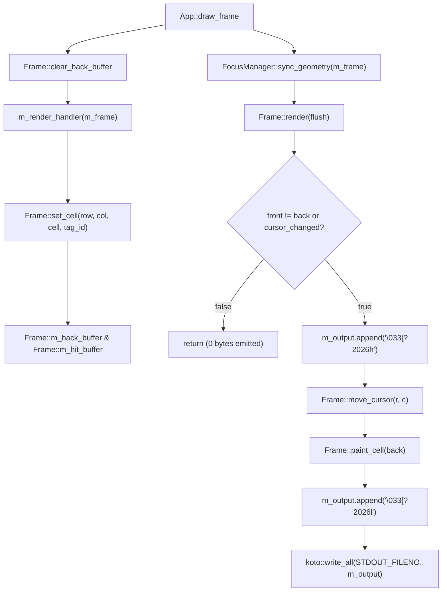

## Overview

The rendering pipeline in `koto::Frame` (`include/koto/frame.hpp`, `src/frame.cpp`) and `koto::Cell` (`include/koto/cell.hpp`) transforms immediate-mode widget draw calls into a single synchronized ANSI byte stream per dirty frame.

<!-- src: include/koto/cell.hpp:29-75 -->
<!-- src: src/frame.cpp:67-440 -->

## Mermaid diagram

## Walkthrough

1. **Back-buffer reset (`Frame::clear_back_buffer`, `src/frame.cpp:179-189`)**:
   - Resets all elements of `m_back_buffer` to default `Cell{}` (`ch = U' '`, `fg = COLOR_DEFAULT`, `bg = COLOR_DEFAULT`, `width = 1`, `continuation = false`, `attrs = 0`), fills `m_hit_buffer` with `TAG_NONE` (`-1`), clears `m_tag_bounds`, and resets `m_cursor_visible = false`, `m_cursor_row = -1`, `m_cursor_col = -1`.
2. **Cell staging and wide-character repair (`Frame::set_cell`, `src/frame.cpp:67-141`)**:
   - Rejects out-of-bounds `(row, col)`.
   - Repair rule 1: If `col > 0 && m_back_buffer[idx].continuation`, overwrites the left-hand owner cell `m_back_buffer[idx - 1]` with `Cell{U' '}`.
   - Repair rule 2: If `m_back_buffer[idx].width == 2 && col + 1 < m_cols`, resets `m_back_buffer[idx + 1]` to `Cell{}`.
   - Resolves effective width `w` (`1` or `2`). If `w == 2 && col + 1 >= m_cols`, replaces `c` with `Cell{U' '}` of width `1` to prevent right-margin terminal wrap.
   - Repair rule 3: If `w == 2 && col + 1 < m_cols`, clears `m_back_buffer[idx + 2]` if `m_back_buffer[idx + 1]` was previously a width-2 head, then writes `Cell::make_continuation()` to `m_back_buffer[idx + 1]` (and stamps `tag_id` into `m_hit_buffer[idx + 1]`).
   - Writes `c` to `m_back_buffer[idx]` and updates `m_hit_buffer[idx]` and `m_tag_bounds[tag_id.value()]`.
3. **Differential scan and SGR state compression (`Frame::render` & `Frame::paint_cell`, `src/frame.cpp:200-440`)**:
   - `render()` first checks whether any cell with `!back.continuation` satisfies `!(m_front_buffer[idx] == m_back_buffer[idx])` or whether cursor visibility/coordinates changed since the last frame. If neither changed, `render()` returns immediately.
   - Wraps output in DEC Mode 2026 (`[?2026h` .. `[?2026l`) and resets tracked SGR state (`m_cur_fg = ~0u`, `m_cur_bg = ~0u`, `m_cur_attrs = 0xFF`).
   - For each dirty non-continuation cell at `(r, c)`, calls `move_cursor(r, c)` (`[%d;%dH` using 1-based coordinates) unless `r == cursor_row && c == cursor_col && last_cell_was_ascii` (`back.width == 1 && back.ch >= 0x20 && back.ch < 0x7F && back.grapheme.size == 1`).
   - `paint_cell(back)` emits `` when any previously active attribute bit is cleared, emits ``/`2m`/`3m`/`4m`/`7m`/`9m` for newly enabled `TextAttr` bits, emits foreground and background SGR codes according to `m_term->color_mode()` (`TrueColor`, `Ansi256`, `Ansi16`, or `NoColor`) only when `c.fg != m_cur_fg` or `c.bg != m_cur_bg`, and appends `c.grapheme.view()`.
   - Copies `back` into `front` (and `m_back_buffer[idx + 1]` into `m_front_buffer[idx + 1]` when `back.width == 2`).
   - Appends cursor show/hide (`[?25h` or `[?25l`), `[?2026l`, and flushes via `write_all(STDOUT_FILENO, m_output)` and `fflush(stdout)`.

<!-- src: src/frame.cpp:67-440 -->

## Invariants

- **Cache-line `Cell` size**: `static_assert(sizeof(Cell) == 64)` (`include/koto/cell.hpp:74`) guarantees that every `Cell` occupies exactly one 64-byte cache line (`Grapheme` 44B + `ch` 4B + `fg` 4B + `bg` 4B + `width` 1B + `continuation` 1B + `attrs` 1B + `reserved` 5B).
- **Post-Unicode cursor resynchronization**: `last_cell_was_ascii` is set to `false` after painting any non-ASCII or width-2 cell (`src/frame.cpp:395-401`), forcing an explicit `;cH` cursor positioning sequence before the next dirty cell so font/emulator width discrepancies can never drift subsequent cells.
- **No orphaned continuation cells**: The three repair steps in `Frame::set_cell` (`src/frame.cpp:73-120`) guarantee that every cell with `continuation == true` is preceded at `col - 1` by a cell with `width == 2`, and every cell with `width == 2` is followed at `col + 1 < m_cols` by a cell with `continuation == true`.

<!-- src: include/koto/cell.hpp:29-75 -->
<!-- src: src/frame.cpp:73-125 -->
<!-- src: src/frame.cpp:391-409 -->

## See also

- [Frame](/api/frame/)
- [Cell and Color](/api/cell-color/)
- [Frames and Diff Renderer Concept](/concepts/frames-diff-renderer/)
- [Performance Deep Dive](/deep-dives/performance/)
